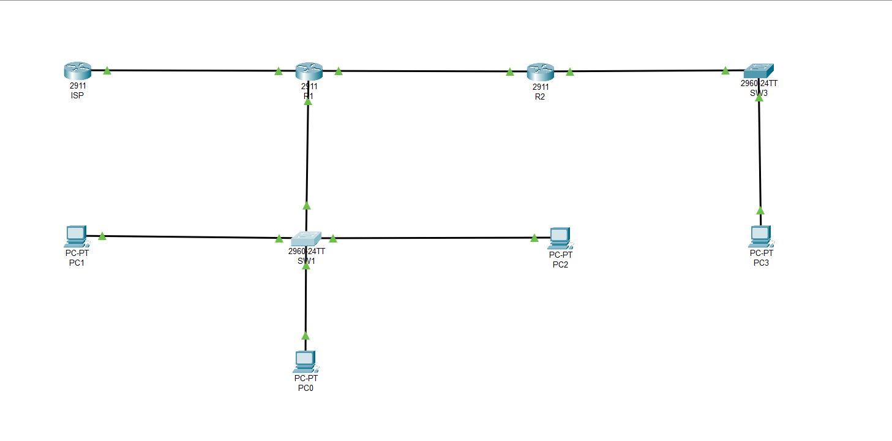

# CCNA Lab: Small Enterprise Network (2 Sites)

 Giới thiệu
Dự án này là bài lab thực hành môn CCNA (Cisco Certified Network Associate) mô phỏng mạng doanh nghiệp nhỏ gồm 1 trụ sở chính (HQ) và 1 chi nhánh (Branch) kết nối với Internet thông qua ISP giả lập.

  Công nghệ sử dụng
- **Phần mềm:** Cisco Packet Tracer 8.x
- **Công nghệ cấu hình:**
  - VLAN & Trunking (802.1Q)
  - Inter-VLAN Routing (Router-on-a-stick)
  - DHCP Server trên Router
  - Định tuyến động OSPF Area 0 & Default Route
  - NAT Overload (PAT) ra Internet
  - Access Control List (ACL) cách ly mạng Guest
  - SSH thay thế Telnet
  - Port Security (Sticky MAC) trên Switch

Sơ đồ mạng

 📂 Cấu trúc thư mục
- `configs/Lab_Completed.pkt`: File Packet Tracer hoàn chỉnh.
- `configs/*.txt`: File cấu hình chi tiết của từng thiết bị (R1, R2, SW1, ISP).
- `docs/`: Tài liệu hướng dẫn bài lab gốc.

## ✅ Kết quả đạt được
- [x] Các PC nhận IP động từ DHCP đúng VLAN.
- [x] PC VLAN 10 (Sales) và VLAN 20 (IT) ping được nhau.
- [x] PC chi nhánh (Branch) ping được PC trụ sở (qua OSPF).
- [x] Các PC ra được Internet (ping 8.8.8.8) qua NAT.
- [x] Mạng Guest (VLAN 30) bị ACL chặn không vào được mạng nội bộ, nhưng vẫn ra được Internet.
- [x] Đăng nhập SSH vào R1 và SW1 thành công.
- [x] Cổng Switch bị err-disabled khi cắm thiết bị lạ (Port Security).

